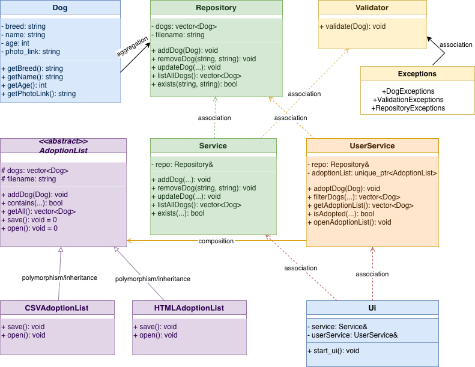

# Dog Shelter Adoption App

A desktop application in C++ and Qt for a dog shelter, with two modes:

- **Admin mode:** add, remove and update dogs, with undo/redo (buttons or Ctrl+Z / Ctrl+Y)
- **User mode:** browse the dogs one by one, filter them by breed and maximum age, adopt them, and see the adoption list as a table or open it as a CSV or HTML file



## Features

- **Layered architecture:** domain, repository, service and UI layers, each in its own folder
- **Undo / redo** using the **Command design pattern**
- **Polymorphism:** the adoption list is saved as CSV or HTML through a common `AdoptionList` base class
- **Validation and custom exceptions** (`ValidationException`, `RepositoryException`)
- **Qt model/view:** the adoption list is displayed with a custom `QAbstractTableModel`
- Data saved to a text file; **unit tests** for the domain, repository and services

## Project structure

```
dog-shelter/
├── main.cpp
├── CMakeLists.txt
├── data/dogs.txt          # sample dogs
├── domain/                # Dog, Validator, exceptions
├── repository/            # Repository (text file), AdoptionList (CSV / HTML)
├── service/               # Service (admin), UserService (user), undo/redo commands
├── ui/                    # Qt windows: main, admin, user, adoption table model
│   └── console/           # earlier console version of the interface (not built)
└── tests/                 # unit tests
```

## How to build and run

You need CMake and Qt 6. On macOS: `brew install qt cmake`.

```bash
cmake -S . -B build
cmake --build build
cd build
./DogShelter
```

Or open the folder in CLion and run the **DogShelter** configuration.

The unit tests run automatically every time the app starts.

If the app starts with no dogs, copy `data/dogs.txt` into the build folder (for example `cmake-build-debug`).

> Opening dog photos and the adoption list uses the macOS `open` command.
